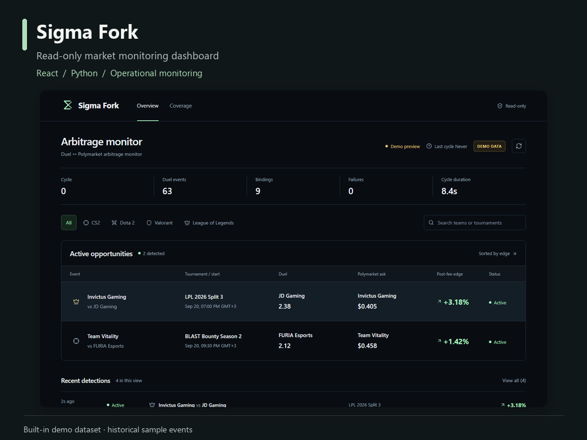

# Sigma Fork

Read-only esports market-comparison foundations with an operational monitoring dashboard.



**React · Python · Monitoring · Data visualization**

[Watch the 45-second dashboard walkthrough](docs/media/demo.mp4) · [Detection details](docs/media/03-sigma-detail.png) · [Collection coverage](docs/media/04-sigma-coverage.png)

## Dashboard features

- Monitoring overview with an explicit demo state.
- Sport filters, event search and detection history.
- Detailed views of both market sides, reported fees, liquidity and observation age.
- Collection-coverage cards and service-health information.
- A bounded, read-only Python API that exposes an allowlisted operational schema.

## Run the dashboard demo

The dashboard runs independently from the provider collectors. The demo requires no provider credentials and does not send notifications or place orders.

From `dashboard`, using Node.js 22+:

```sh
npm ci
npm run build
```

Then, from the repository root, using Python 3.11+:

```sh
python -m dashboard.api.server --demo --health-file dashboard/data/no-live-health.json
```

Open `http://127.0.0.1:4310`. The server binds to loopback and the UI explicitly labels sample content as **DEMO DATA**.

For frontend development, keep that API running and start `npm run dev` inside `dashboard`. Vite serves the UI at `http://127.0.0.1:4311` and proxies `/api` to the local API.

## Checks

From the repository root:

```sh
python -m unittest discover -s dashboard/tests -v
```

From `dashboard`:

```sh
npm test
npm run build
```

## Repository map

| Path | Purpose |
| --- | --- |
| `dashboard/src` | React interface, filters and detailed views |
| `dashboard/api` | Read-only state projection and local HTTP API |
| `dashboard/data/demo-state.json` | Labelled historical sample events |
| `dashboard/tests` | API contract and data-boundary tests |
| `backend/src/provider_odds` | Provider, matching and realtime foundations |
| `backend/tests` | Unit tests and fixture-based integration scenarios |

## Demonstration scope

The media shows real dashboard interactions using the built-in historical demo dataset. It does not demonstrate current provider access, live arbitrage opportunities, achieved profit or production reliability. Provider integrations are separately constrained by source availability and access conditions. The dashboard has no account, betting or order-execution controls.

The independently runnable dashboard demo is the recommended entry point. The included backend is an earlier standard-library implementation of the provider and comparison foundations; see `backend/README.md` for offline checks. This portfolio snapshot excludes private deployment configuration and operational history.
